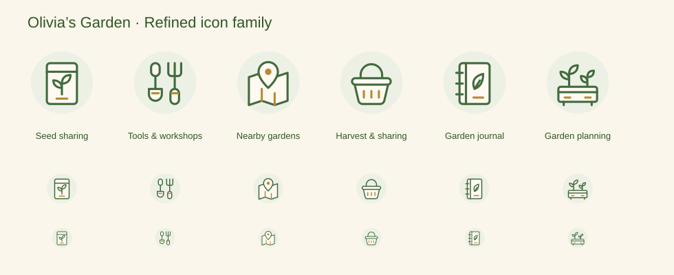

# Visual polish and image brief

This pass tightens the existing cream-and-green presentation and uses the photos already in the repository. No new photography is required to use the updated pages.

## Included

- Restrained standard page titles, normal heading letter spacing, stronger muted copy, and lighter card shadows on the foundation site.
- Donation options immediately after a compact introduction, with the longer story below. Phone amount buttons use two columns; selected frequency and amount have an explicit state.
- Good Roots opens with the existing garden-designer screenshot on desktop and mobile, with sample data identified.
- Get Involved has a two-column desktop grid, small illustrations, and explicit availability labels. Future activities have secondary actions.
- The contact form precedes supporting details in mobile/document order; desktop retains the side-by-side composition.
- Guest seed requests show account actions only when the visitor expands the optional account section.
- Shared workshop/store empty states and a catalog error with retry/contact actions. The underlying production catalog failure still needs separate diagnosis; this change does not fix its API or deployment.
- Share in Good Roots uses the same garden icon family instead of platform-dependent emoji.

## Iconography drafts

The six decorative SVG icons are seed packet, tools, map, harvest basket, journal, and raised bed. They use a 64-unit grid, consistent rounded strokes, garden green, a pale wash, and small gold details. Their visible labels carry the meaning, so assistive technology skips the SVGs. These are lightweight vector drafts in `packages/ui/src/components/GardenIcon.tsx`, not generated bitmap assets. Journal is included for future use; this pass does not redesign the authenticated journal or garden designer.

## Images requested

Please provide original, unfiltered files where possible. Landscape photos around 2400 × 1600 pixels or larger give useful cropping room. Keep the subject clear, avoid text baked into photos, and leave a little space around it for phone crops. Take a portrait alternative when a close-up is important. Use only photographs and names the foundation has permission to publish.

| Priority | Image | What to capture | Intended use / suggested filename |
| --- | --- | --- | --- |
| First | Memorial markers installed in the garden | One wide view showing several markers among plants, plus a close-up of one named bee. Soft morning/evening light; the garden should visibly be the setting. | Donate and donor story: `images/donate/markers-in-garden.jpg`, `images/donate/marker-detail.jpg` |
| First | Actual seed packet and mailing work | The packet people receive, with okra pods or seeds nearby; a second photo of packets being prepared. Keep addresses and private contact information out of frame. | Okra and Impact: `images/okra/seed-packet.jpg`, `images/impact/preparing-seeds.jpg` |
| First | Current garden progress | Two or three dated photographs of productive beds, a harvest, and work on the property. Supply a short factual caption and approximate month/year. | Impact: `images/impact/garden-beds.jpg`, `images/impact/harvest.jpg`, `images/impact/garden-work.jpg` |
| Next | Olivia’s Colossus marigolds | A close-up bloom and a wider photograph showing where they grow in the garden. Keep warm natural color. | About and a memorial detail: `images/about/colossus-marigolds.jpg` |
| Optional | Garden Club shirt | Actual shirt laid flat or worn, showing the real design and color. Front and back if both are printed. | Monthly-giving explanation: `images/donate/garden-club-shirt.jpg` |
| When available | Hands-on learning or volunteering | Real participants doing the actual activity, with appropriate publication permission. Capture hands/tools and a wider scene. | Workshops/Get Involved once sessions happen: `images/workshops/hands-on-learning.jpg` |

There is no need to create replacement logo art or new Good Roots screenshots for this pass: the current designer screenshot is already used. When the app changes materially, replace the marketing examples with current screenshots, retaining their sample-data labeling.

## Review checks

Check desktop and phone layouts, keyboard focus, decorative icon accessibility, selected donation controls, optional-account disclosure, and error retry. Existing checkout payloads, validation, auth, API contracts, and program availability remain intact. No donations, registrations, or real seed requests are needed for the focused presentation tests.
